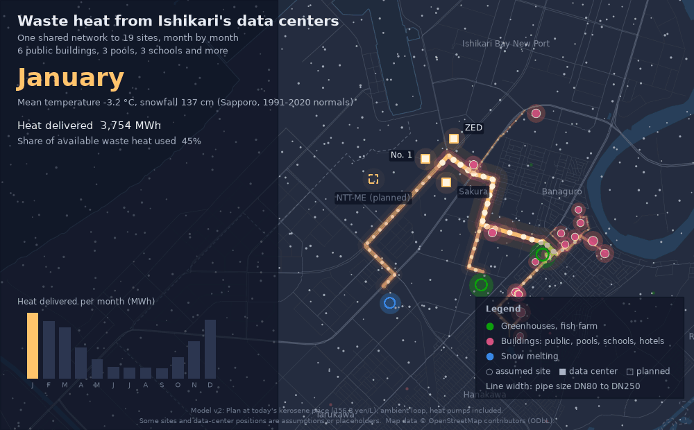
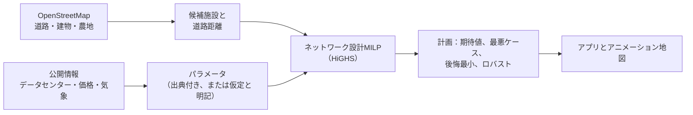

# Team Data Center

**北海道・石狩のデータセンターの最適化。** 排熱をどこへ届けるか。電力系統は新しい負荷をどれだけ受け入れられるか。次のデータセンターをどこに建てるか。

[English](README.md)



*改良版モデル（v2）の期待値最大化の計画です。1本の共同の導管網で、石狩湾新港の2つのデータセンターの排熱を、プール3か所・中学校・陸上養殖・道路融雪に届けます。線の太さは管の太さを、下の棒グラフは月ごとに届けた熱を表します。施設とデータセンターの位置には、仮定や仮置きのものが含まれます（[データと出典](#データと出典)）。地図データ © OpenStreetMap contributors（ODbL）。*

## このプロジェクトについて

[Hack × Hokkaido Build Week 2026](https://www.hackhokkaido.com/) で始めたプロジェクトです。このイベントは、2026年11月23〜27日に札幌で開かれたAIのビルドウィークで、海外のエンジニアと北海道の人たちが、オープンデータを使って北海道の課題の試作品を作ります。応募するリポジトリは、MITライセンスで公開することになっています。

私たちは、アイデアスターターの **「Warm Ishikari」** を選びました。データセンターの排熱の熱源と使い手（温室・陸上養殖・融雪・浴場）を地図に載せ、使える熱・距離・節約額を見積もります。そのうえで、見込みのあるペアごとに1枚の提案書を作ります。どの数字にも出典を付けるか、仮定と明記します。私たちはこれを最適化の問題として扱い、3つの研究テーマに広げました。イベントの後も研究を続ける予定です。

## なぜ重要か

- **データセンターが集まりつつある。** 石狩湾新港には複数のデータセンターがあります。そのひとつ、石狩再エネデータセンター第1号は、2026年8月1日に再エネ100%で稼働を始めました。国の「ワット・ビット連携」（2025年）は、大規模なデータセンター集積地を電源の近くに置くための基準を示しています。
- **排熱を捨てる隣で、燃料を燃やしている。** 空冷のサーバーの排熱（25〜40℃程度）は、ほとんどが捨てられています。一方、近くの温室・プール・浴場・融雪では灯油を燃やしています。北海道の灯油価格は、2026年11月16日の国の調査で156.8円/Lです。
- **海外では再利用が義務になっている。** EUでは、1MWを超えるデータセンターに、費用便益分析で不可能と示されない限り排熱の利用を求めています。日本にはまだ同様の決まりがありません。

## 3つの研究テーマ

| | 問い | 方法 | 状況 |
|---|---|---|---|
| 1. 排熱の導管網 | どの施設を、どのデータセンターに、どの道路沿いに、どの太さの管でつなぐか | 月別の熱収支つきのネットワーク設計MILP（確率計画版・ロバスト版） | モデルv1・v2、アプリ、アニメーション地図 |
| 2. 系統の受け入れ余地 | データセンターとヒートポンプの負荷を、系統のどこにどれだけ受け入れられるか | 交流最適潮流の凸緩和（SDP/SOCP）による上限の保証と、実行可能な解 | 予定 |
| 3. 立地 | 次のデータセンターをどこに建てるか | テーマ1と2の結果を使う施設配置問題 | 予定 |

## これまでの結果（テーマ1）

数字はすべて年間の正味の便益（百万円）です。便益は「置き換えた灯油の価値 − ヒートポンプの電気代 − 導管とヒートポンプの投資の年額」で、4つのシナリオの平均をとっています。シナリオは、IT負荷が低い・高いと、灯油が115円/L・156.8円/Lの組み合わせです。

### 共同の導管網は、ペアごとの組み合わせに勝つ

各施設をデータセンターと1対1で組む方法（アイデアスターターの「順位付きの相手5件」）は、最適化した共同の導管網の **63〜77%** しか稼げません。

| データセンター | 導管の温度方式 | 最適化した導管網 | ペア上位5件 | ペアの割合 |
|---|---|---|---|---|
| 第1号 | 低温方式 | 84.5（6か所、5.0km） | 65.3（3か所、5.1km） | 77% |
| さくら | 低温方式 | 81.6（6か所、5.2km） | 58.4（2か所、3.4km） | 72% |
| ZED | 低温方式 | 80.6（5か所、3.0km） | 59.6（3か所、4.9km） | 74% |
| 第1号 | 集中方式 | 62.6（10か所、7.5km） | 40.4（4か所、6.8km） | 65% |
| さくら | 集中方式 | 59.5（9か所、6.3km） | 37.2（2か所、3.4km） | 63% |
| ZED | 集中方式 | 52.1（5か所、3.0km） | 36.8（4か所、6.2km） | 71% |

差が生まれる理由は3つあります。

1. **管が重複しない。** 5か所を別々の管でつなぐと道路に沿って9.3km必要ですが、共同の導管網なら3.0kmで済みます。
2. **単独では赤字の施設も、枝管なら黒字になる。** 第1号から2.8km離れたプールは、専用管を引くと年に約850万円の赤字です。ヒートポンプの費用を引いた熱の価値は年に約860万円なので、枝管が約1.4kmより短ければ黒字になります。
3. **太い管ほど、熱あたりの費用が安い。** 運ぶ熱1MWあたりで比べると、DN250の管1mの費用はDN80の約7分の1です。

### ロバスト計画は、計画中のデータセンターに頼らない

- **名目どおりの場合の最適計画。** すべてのデータセンターが名目どおりのIT負荷で動く前提だと、最適な計画は年6,600万円です。この計画は、道路融雪の熱を計画中のNTT-MEのデータセンターからもらいます。
- **そのデータセンターが建たない場合。** 便益は3,300万円に半減します。
- **ロバスト計画。** 同時に低負荷になるデータセンターを最大1か所までとした計画で、列・制約生成法で解きます。この計画はその接続を外し、**どの場合でも6,120万円**を確保します。
- **代償。** 名目の便益の7.3%を手放す代わりに、50%の損失を避けます。

### ヒートポンプの費用まで含めると、低温方式が勝つ

30℃程度の低温の導管網で、ヒートポンプを各施設に置く方式です。陸上養殖と道路融雪は、熱をそのまま使います。この方式の期待値は **8,530万円** で、60℃の導管網と集中ヒートポンプの方式（**6,260万円**）を上回ります。

### 注意点

- **解は最適と保証されていない。** 計画は、LPで候補を絞ったカーネル探索で求めています。HiGHSの上界とのギャップは13〜21%です。
- **データセンターの位置。** 2か所はおおよその位置、1か所は仮置きです。
- **モデルの粗さ。**
  - 熱の収支は月単位です。
  - 熱損失は一律の割合で、距離に応じた損失はこれから入れます。

詳しくは [docs/formulations/heat.md](docs/formulations/heat.md) を見てください。

## 仕組み



**モデルの要点**
- **網：** 候補の区間は、データセンターと施設を結ぶ道路沿いの経路です。0-1変数で、区間を開設して管の太さを選び、施設をつなぎ、それぞれをどれか1つのデータセンターに割り当てます。
- **熱の経路：** 強い多品種流の定式化で、各施設の熱をそのデータセンターから運びます。
- **月ごとの収支：** 届ける熱は、施設の需要と各データセンターの排熱で上限が決まります。
- **目的：** 熱の価値から年額の費用を引いた値を最大にします。
- **不確実性への対応：**
  - 確率計画版は、どのシナリオでも同じ導管網を使います。
  - ロバスト版には3つあります。最悪ケースを最大にするもの、最大後悔を最小にするもの、IT負荷のバジェット型不確実性集合に対して守るものです。

## 使い方

```bash
uv sync
uv run python scripts/fetch_data.py --area ishikari    # OpenStreetMapの地図データを data/cache に取得（コミットしない）
uv run python scripts/export_heat_story.py             # 地図ページ用の下地とデータ
uv run streamlit run app/streamlit_app.py              # デモアプリ
uv run pytest                                          # テスト（地図データが必要なものは、データがなければスキップ）
```

**実験**
- v1とv2の比較：`uv run python experiments/heat_v2_compare/run.py`
- ロバスト計画の掃引：`uv run python experiments/heat_ccg/run.py ambient`

**上のアニメーションの作り直し方**
1. `uv run python scripts/export_heat_network_v2.py`
2. `uv run python scripts/render_readme_animation.py`

## 構成

```
src/dcopt/heat      テーマ1：モデルv1（v1.py）とv2（network.py）
src/dcopt/grid      テーマ2
src/dcopt/siting    テーマ3
src/dcopt/common    共通：道路網、配色
app/                Streamlitのアプリ
web/heat_story/     アニメーション地図のページ
scripts/            データ取得、書き出し、図
experiments/        再現できる実験（結果は results/ に保存し、コミットしない）
docs/               定式化、データの出典、図
data/curated/       自分たちでまとめた小さな表（各値に出典付き）
tests/              合成データでの単体テストとアプリのテスト
```

## データと出典

- **数字の出典：** すべての数字に出典を付けるか、仮定と明記しています。URL付きの一覧は [docs/data-sources.md](docs/data-sources.md) にあります。対象は、石狩のデータセンター、価格、導管とヒートポンプの費用、気象の平年値、先行事例です。
- **地図データ：** OpenStreetMapのデータ（© OpenStreetMap contributors、ODbL）は、スクリプトで `data/raw/` と `data/cache/` に取得し、コミットしません。アニメーションはOpenStreetMapのデータから作った画像で、その旨を明記しています。
- **仮定の施設：** 陸上養殖、温室の新設候補、道路融雪の区域は仮定で、白抜きの印で描いています。
- **データセンターの位置：** 第1号とZEDはおおよその位置です。NTT-MEの用地は公表されていません。

## ソルバー

- **既定はオープンソース：** MILPはHiGHSで解きます。テーマ2の錐計画には、ClarabelかSCSを使う予定です。
- **Gurobi：** 入っていれば使えます（`DCOPT_SOLVER=gurobi`）。どの機能もGurobiを必須にはしていません。

## 次の研究課題

- 管の太さの定式化を強化し（カット平面、Benders）、最適性を保証する
- 網の形・温度方式・ヒートポンプの置き場所を、道路網の規模で同時に最適化する
- 管の長さ・太さ・温度・流量に応じた熱損失を入れる
- 共同の幹線の費用を公平に分ける（シャープレイ値と最小コアの比較）
- どの計画中のデータセンターが建つかが不確かなときの、2段階ロバスト設計
- 出力を調整できるデータセンター負荷について、SDP/SOCP緩和で系統の受け入れ余地を保証する
- 排熱の利用・系統の余地・再エネ・通信・災害リスクを合わせた立地

## メンバー

Adam Curnow, Junko, Lia Vergou, Noriyuki Sugita, Paul Binder, Seiko Yamaguchi, Thomas Braam

## ライセンスと引用

コードはMITライセンスです（[LICENSE](LICENSE)）。外部のデータは、それぞれのライセンスに従います。引用の方法は [CITATION.cff](CITATION.cff) を見てください。
