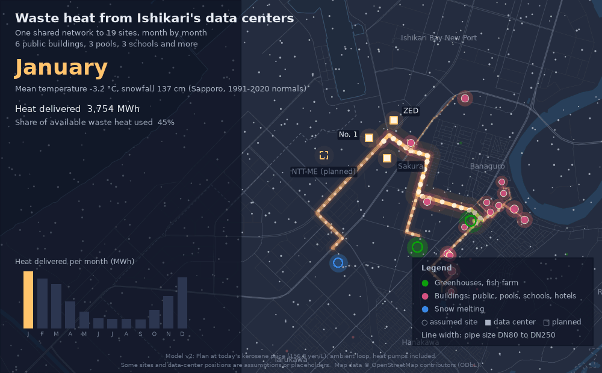
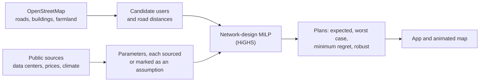

# Team Data Center

**Optimization for data centers in Ishikari, Hokkaido.** Where should their waste heat go? How much new load can the power grid host? Where should the next data center be built?

[日本語版 / Japanese](README.ja.md)



*Model v2, expected plan. One shared network carries waste heat from two data centers in the Ishikari Bay New Port to three pools, a school, a fish farm and road heating. Line width shows the pipe size, and the bars show the heat delivered each month. Several sites and data-center positions are assumptions or placeholders ([Data and sources](#data-and-sources)). Map data © OpenStreetMap contributors (ODbL).*

## About

This project started at [Hack × Hokkaido Build Week 2026](https://www.hackhokkaido.com/), an AI build week in Sapporo (23–27 November 2026). There, international engineers and people from Hokkaido build prototypes for Hokkaido's problems from open data. Entries are public repositories under the MIT license.

We took the idea starter **"Warm Ishikari"**: a matchmaker and calculator for data-center waste heat. It maps heat sources and possible users (greenhouses, aquaculture, snow melting, public baths) and estimates the heat available, the distance and the saving. It then drafts a one-page proposal for each promising pair, with every number either sourced or marked as an assumption. We treat the task as an optimization problem and extend it into three research themes. The team plans to continue the research after the event.

## Why it matters

- **Data centers are arriving.** Ishikari Bay New Port hosts several data centers. One of them, Ishikari Renewable Energy Data Center No. 1, started service on 1 August 2026 on 100 % renewable power. Japan's "watt-bit" policy (2025) sets criteria for siting large data-center clusters near power supply.
- **Their heat is wasted while fuel is burned next door.** The waste heat of air-cooled servers (about 25–40 °C) is mostly released. Meanwhile, nearby greenhouses, pools, baths and snow melting burn kerosene, which cost 156.8 yen/L in Hokkaido in the government survey of 16 November 2026.
- **Rules elsewhere already require reuse.** In the EU, data centers above 1 MW must use their waste heat unless a cost-benefit analysis shows it is not feasible. Japan has no such rule yet.

## Three research themes

| | Question | Method | Status |
|---|---|---|---|
| 1. Waste-heat networks | Which users connect to which data center, along which streets, with which pipes? | Network-design MILP with monthly heat balances; stochastic and robust versions | Models v1 and v2, app and animated map |
| 2. Grid hosting capacity | How much data-center and heat-pump load can each grid location take? | AC optimal power flow with convex (SDP/SOCP) relaxations: certified upper bounds plus feasible points | Planned |
| 3. Siting | Where should the next data center go? | Facility location using the results of themes 1 and 2 | Planned |

## Results so far (theme 1)

All figures are annual net benefits in million yen, averaged over four scenarios: IT load low or high, crossed with kerosene at 115 or 156.8 yen/L. The net benefit is the value of the kerosene replaced, minus heat-pump electricity, minus the annualized cost of pipes and heat pumps.

### A shared network beats pair-by-pair matching

Matching each user to a data center on its own, the "five ranked partners" of the idea starter, reaches only **63–77 %** of what an optimized shared network earns.

| Data center | Network temperature | Optimized network | Top-5 pairs | Pairs reach |
|---|---|---|---|---|
| No. 1 | ambient loop | 84.5 (6 sites, 5.0 km) | 65.3 (3 sites, 5.1 km) | 77 % |
| Sakura | ambient loop | 81.6 (6 sites, 5.2 km) | 58.4 (2 sites, 3.4 km) | 72 % |
| ZED | ambient loop | 80.6 (5 sites, 3.0 km) | 59.6 (3 sites, 4.9 km) | 74 % |
| No. 1 | central heat pump | 62.6 (10 sites, 7.5 km) | 40.4 (4 sites, 6.8 km) | 65 % |
| Sakura | central heat pump | 59.5 (9 sites, 6.3 km) | 37.2 (2 sites, 3.4 km) | 63 % |
| ZED | central heat pump | 52.1 (5 sites, 3.0 km) | 36.8 (4 sites, 6.2 km) | 71 % |

Three effects explain the gap:

1. **No duplicated pipes.** Serving five users with separate pipes takes 9.3 km of road; the shared network takes 3.0 km.
2. **Users that lose money alone pay off on a branch.** A pool 2.8 km from data center No. 1 loses about 8.5 M yen a year with its own pipe. Its heat is worth about 8.6 M yen a year after heat-pump costs, so it pays off on any branch shorter than about 1.4 km.
3. **Large pipes are cheaper per unit of heat.** Per megawatt carried, a metre of DN250 pipe costs about one seventh of a metre of DN80.

### Robust planning avoids leaning on a planned data center

- **The nominal plan.** With every data center at its nominal IT load, the best plan earns 66.0. It feeds road heating from the planned NTT-ME data center.
- **What happens if that center is not built.** The plan then earns only 33.0.
- **The robust plan.** It allows at most one data center at its low IT load and is solved by column-and-constraint generation. It drops that link and keeps **61.2 in every case**.
- **The trade-off.** The plan gives up 7.3 % of the nominal value to avoid a 50 % loss.

### The low-temperature loop wins once heat pumps are paid for

An ambient loop at about 30 °C puts heat pumps at the users, and the fish farm and the road heating take the heat directly. It earns **85.3** in expectation, against **62.6** for a central heat pump feeding a 60 °C network.

### Caveats

- **Optimality.** Plans come from an LP-guided kernel search, not a certified optimum: the gaps against HiGHS bounds are 13–21 %.
- **Positions.** Two data-center positions are approximate and one is a placeholder.
- **Model scope.** The model balances energy month by month, and heat losses are a flat percentage. Distance-dependent losses are next.

Details: [docs/formulations/heat.md](docs/formulations/heat.md).

## How it works



**The model in one paragraph.**
- *Network.* Candidate links follow streets between data centers and users. Binary variables open a link with a pipe size, connect a user, and assign it to one data center.
- *Routing.* A strong multi-commodity flow formulation routes each user's heat from its data center.
- *Monthly balances.* Deliveries are limited by each user's demand and by each data center's waste heat.
- *Objective.* Maximize the value of the heat minus annualized costs.
- *Uncertainty.* The stochastic version shares one build across scenarios. The robust versions maximize the worst case, minimize the largest regret, or protect against a budgeted uncertainty set on IT loads.

## Quick start

```bash
uv sync
uv run python scripts/fetch_data.py --area ishikari    # map data from OpenStreetMap into data/cache (not committed)
uv run python scripts/export_heat_story.py             # base map and data for the animated map page
uv run streamlit run app/streamlit_app.py              # the demo app
uv run pytest                                          # tests; those that need map data skip without it
```

**Experiments**
- Model v1 against v2: `uv run python experiments/heat_v2_compare/run.py`
- Robust sweep: `uv run python experiments/heat_ccg/run.py ambient`

**Redrawing the animation above**
1. `uv run python scripts/export_heat_network_v2.py`
2. `uv run python scripts/render_readme_animation.py`

## Repository layout

```
src/dcopt/heat      theme 1: model v1 (v1.py) and v2 (network.py)
src/dcopt/grid      theme 2
src/dcopt/siting    theme 3
src/dcopt/common    shared code: road network, styles
app/                Streamlit app
web/heat_story/     animated map page
scripts/            data download, exports, figures
experiments/        reproducible experiments (outputs go to results/, not committed)
docs/               formulations, data sources, figures
data/curated/       small tables we compiled, each value with its source
tests/              unit tests on synthetic instances and app tests
```

## Data and sources

- **Every number has a source or is marked as an assumption.** The list, with URLs, is in [docs/data-sources.md](docs/data-sources.md). It covers the data centers in Ishikari, prices, pipe and heat-pump costs, climate normals and precedents.
- **Map data.**
  - Scripts download OpenStreetMap data (© OpenStreetMap contributors, ODbL) into `data/raw/` and `data/cache/`. This data is not committed.
  - The animation is a produced work from OpenStreetMap data and is credited as such.
- **Assumed sites.** The fish farm, the new greenhouses and the road-heating areas are assumptions, drawn as hollow markers.
- **Data-center positions.** The positions of No. 1 and ZED are approximate, and NTT-ME's site has not been published.

## Solvers

- **Open source by default.** HiGHS solves the MILPs; conic problems (theme 2) will use Clarabel or SCS.
- **Optional commercial solver.** Gurobi can be used when installed (`DCOPT_SOLVER=gurobi`), but no part of the code requires it.

## Next research questions

- Certify optimality with a stronger pipe-sizing formulation (cut-set inequalities, Benders cuts).
- Co-optimize the network layout, the temperature level and where heat pumps go, at street scale.
- Model heat losses that depend on pipe length, size, temperature and flow.
- Share the cost of a common trunk fairly: the Shapley value against the least core.
- Two-stage robust design when it is uncertain which planned data centers will be built.
- Certified grid hosting capacity from SDP/SOCP relaxations, for flexible data-center loads.
- Siting that combines heat reuse, grid capacity, renewables, fiber and hazards.

## Team

Adam Curnow, Junko, Lia Vergou, Noriyuki Sugita, Paul Binder, Seiko Yamaguchi, Thomas Braam

## License and citation

The code is under the MIT license ([LICENSE](LICENSE)). Data from other sources keeps its own license. To cite this work, see [CITATION.cff](CITATION.cff).
